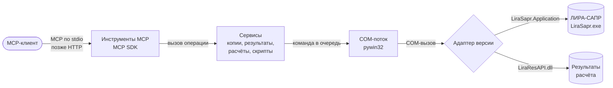

# Архитектура — Lira-Sapr-MCP

Status: draft

## Общая картина

Сервер — один процесс Python на компьютере с ЛИРОЙ. MCP-клиент (Claude, Codex, Hermes и
другие) запускает его сам и общается с ним через стандартный ввод-вывод (stdio). Внутри
процесса четыре слоя; каждый следующий ближе к ЛИРЕ.

Как читать: стрелки — направление запроса, подписи — что передаётся. Путь одного
запроса: агент вызывает инструмент, например «прочитать таблицу узлов» → слой инструментов
проверяет параметры и вызывает сервис → сервис ставит команду в очередь COM-потока → поток
через адаптер версии обращается к ЛИРЕ → ответ идёт обратно тем же путём, и сервис
превращает его в компактный ответ агенту.

## Части

| Часть | Отвечает за | Сделана на | Код | Страница |
|---|---|---|---|---|
| Инструменты MCP | Описания инструментов и ресурсов, проверка параметров, транспорт | MCP Python SDK 2.x | `src/lira_sapr_mcp/tools/` | [Сервер](components/server.md) |
| Сервисы | Резервные копии, обработка и экспорт результатов, задания расчёта, скрипты агента, справочник таблиц | Python, pandas | `src/lira_sapr_mcp/services/` | [Сервер](components/server.md) |
| COM-поток | Единственный поток, говорящий с ЛИРОЙ: очередь, тайм-ауты, события расчёта, поиск модальных окон | pywin32 | `src/lira_sapr_mcp/com/` | [Сервер](components/server.md) |
| Адаптеры версий | Поиск установленных ЛИР, различия версий, список возможностей | pywin32 | `src/lira_sapr_mcp/adapters/` | [Сервер](components/server.md) |

Главный сценарий целиком: [от задачи до результата](flows/main-scenario.md).

## Стек

| Слой | Выбор | Почему, в одну строку | Решение |
|---|---|---|---|
| Архитектура | Один процесс, четыре слоя, COM-поток | Версии, диалоги и долгий расчёт без закрытия пути к сетевому режиму | [0001](decisions/0001-architecture.md) |
| Язык | Python 3.13 (64 бит) | COM, обработка данных и скрипты агента на одном языке | [0002](decisions/0002-python-stack.md) |
| MCP | Официальный MCP Python SDK 2.x | Поддерживается авторами протокола; stdio и HTTP | [0002](decisions/0002-python-stack.md) |
| COM | pywin32 | Зрелая библиотека COM, события, функции окон Windows | [0002](decisions/0002-python-stack.md) |
| Результаты | pandas, openpyxl (Excel) | Фильтры, сортировки, огибающие; самая известная агентам библиотека | — |
| Картинка модели | Pillow | Открывает EMF на Windows и сохраняет PNG | — |
| Настройки | Файл TOML | Читается стандартной библиотекой Python | — |
| Окружение и установка | uv, `.venv`; у пользователей `uvx` | Одна команда установки с GitHub | — |
| Тесты | pytest | Модульные — на поддельном адаптере; интеграционные — на живой ЛИРЕ | — |
| Качество кода | ruff (проверка и форматирование), pre-commit | Один быстрый инструмент | — |
| Документация | Zensical | Сайт проекта для владельца | — |

## Данные

Базы данных нет. Сервер хранит:

- **Настройки** — файл TOML (папка резервных копий, тайм-ауты, путь к ЛИРЕ при
  нескольких установках). Без файла работают умолчания.
- **Резервные копии моделей** — папка рядом с моделью; сервер их не удаляет.
- **Выгрузки результатов** — CSV/Excel в папке, которую указал агент или пользователь.
- **Журнал** — файл в папке данных пользователя; в stdio-режиме вывод в консоль занят
  протоколом.
- **Задания расчёта** — только в памяти процесса; после перезапуска сервера их состояние
  читается заново из ЛИРЫ и файлов результатов.

## Внешние сервисы

Нет. Нужна только локальная ЛИРА-САПР с действующей лицензией пользователя.

## Запуск и проверка

MCP-клиент запускает сервер командой из `Project commands` в `AGENTS.md`. Проверка:
модульные тесты без ЛИРЫ при каждом коммите; интеграционные и сквозные тесты на живой
ЛИРЕ 2024 R2 перед завершением задачи, работающей с ЛИРОЙ. Тестовые модели создаются
в папке проекта; модели пользователя тесты не трогают.

## Журнал решений

| # | Дата | Решение | Утвердил | Статус |
|---|---|---|---|---|
| [0001](decisions/0001-architecture.md) | 2026-10-27 | Локальный сервер, четыре слоя, COM-поток, диалоги ЛИРЫ (П6) | владелец | accepted |
| [0002](decisions/0002-python-stack.md) | 2026-10-27 | Python, MCP Python SDK, pywin32 | владелец | accepted |
