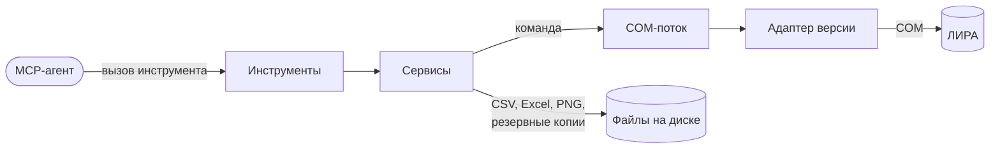

# Сервер

!!! note "Запланировано — ещё не построено"
    Страница описывает утверждённый проект. Ссылки на код появятся по мере его написания.

## Что делает

Принимает вызовы инструментов от MCP-агента, выполняет их в ЛИРЕ-САПР через COM и
возвращает компактный результат. Отвечает за безопасность моделей (резервные копии),
за то, чтобы ЛИРА не «повесила» агента, и за различия версий ЛИРЫ.

## Место в архитектуре

Агент видит только инструменты. Сервисы пишут файлы на диск и ставят команды в очередь;
говорить с ЛИРОЙ может только COM-поток, и только через адаптер.

## Как устроено внутри

### Инструменты MCP

Группы инструментов (имена с префиксом `lira_`):

| Группа | Примеры | Этап |
|---|---|---|
| Сведения | установленные версии, возможности, состояние ЛИРЫ | 1 |
| Файлы | открыть, создать, импортировать, сохранить, закрыть | 1 |
| Модель | сводка модели, список таблиц ввода, прочитать/записать таблицу, выделение | 1 |
| Расчёт | запустить, статус, дождаться, остановить, протокол | 1 |
| Результаты | перемещения, усилия, РСУ, РСН, периоды, арматура — с выборкой и экстремумами; экспорт | 1–2 |
| Высокий уровень | добавить узлы, назначить жёсткость, собственный вес и т.п. | 2 |
| Скрипт | выполнить Python-код агента с объектами ЛИРЫ | 2 |
| Диалоги | показать модальные окна ЛИРЫ, нажать кнопку | 3 |
| Картинка | PNG расчётной схемы | 3 |

Справочник форматов таблиц ввода отдаётся как MCP-ресурс: агент читает его по мере надобности.

### Сервисы

- **Резервные копии:** перед первой правкой или сохранением модели в сессии копируют
  файл `.lir` в папку копий рядом с моделью.
- **Результаты:** получают массивы из `LiraResAPI`, превращают их в таблицы pandas и
  выполняют запрос агента: выбор узлов, элементов, загружений и компонент; сортировку;
  N наибольших; минимум и максимум; огибающую; отбор по порогу. Полные таблицы пишут в
  CSV или Excel.
- **Задания расчёта:** запускают расчёт и сразу отвечают агенту; статус обновляется по
  событиям ЛИРЫ (`AnalysisStarting`, `AnalysisFinished`, `AnalysisStopped`).
- **Скрипты:** выполняют Python-код агента в COM-потоке, передавая ему объекты ЛИРЫ;
  перед запуском делают резервную копию открытой модели.

### COM-поток

COM требует вызывать объект из того потока, в котором он создан. Поэтому сервер
держит один поток, который подключается к ЛИРЕ и выполняет все команды по очереди. Пока
команда выполняется, отдельный наблюдатель следит за временем и ищет модальные окна
процесса `LiraSapr.exe`; если команда превысила тайм-аут из-за окна, агент получает
заголовок и текст окна вместо бесконечного ожидания.

### Адаптеры версий

При старте сервер читает реестр Windows: какие версии ЛИРЫ установлены и под какими
COM-именами зарегистрированы. Адаптер выбранной версии знает её COM-имя
(`LiraSapr.Application` в 2024, `LiraSapphire.Application` в 2025) и публикует список
возможностей; инструменты, которых версия не умеет, агенту не показываются.

## Данные

Настройки (TOML), резервные копии, выгрузки и журнал — см. раздел «Данные» в [архитектуре](../ARCHITECTURE.md).

## Тесты

- Модульные — на поддельном адаптере, без ЛИРЫ: сервисы, обработка результатов, очередь.
- Интеграционные — на живой ЛИРЕ 2024 R2: адаптер, таблицы, расчёт, результаты.
- Сквозные — MCP-клиент из SDK вызывает инструменты сервера, сервер работает с живой ЛИРОЙ.

## Ограничения

- Одна ЛИРА на процесс сервера; команды выполняются последовательно.
- Нагрузки на узлы и элементы: в API 2024 R2 нет таблицы ввода — способ определяется
  экспериментом на этапе 1.
