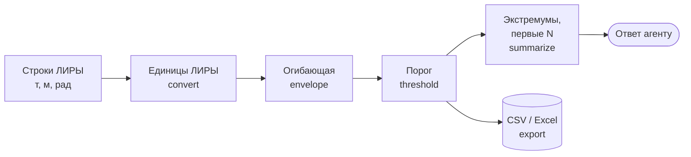

# Сервер

!!! info "Построено: этап 1 и часть этапа 2"
    Работают инструменты сведений, файлов, таблиц ввода, нагрузок, расчёта и всех видов
    результатов с огибающими, порогом и экспортом в CSV/Excel. Остальные группы помечены
    этапом, на котором появятся.

## Что делает

Принимает вызовы инструментов от MCP-агента, выполняет их в ЛИРЕ-САПР через COM и
возвращает компактный результат. Отвечает за безопасность моделей (резервные копии,
отказ закрыть несохранённую модель), за то, чтобы ЛИРА не «повесила» агента
(тайм-ауты), и за различия версий ЛИРЫ.

## Место в архитектуре


Как читать: слева направо идёт вызов агента, каждый прямоугольник — слой кода с его
папкой в `src/lira_sapr_mcp/`. Агент видит только инструменты. Говорить с ЛИРОЙ может
только COM-поток и только через адаптер; результаты расчёта адаптер читает отдельной
библиотекой ЛИРЫ `LiraResAPI` из файлов в рабочей папке.

## Как устроено внутри

### Инструменты MCP

Сорок инструментов, все с префиксом `lira_`. Инструменты только для чтения помечены
для агента признаком `readOnlyHint`.

| Группа | Инструменты | Код |
|---|---|---|
| Сведения и файлы | `lira_status`, `lira_list_models`, `lira_open_model`, `lira_create_model`, `lira_save_model`, `lira_close_model`, `lira_model_summary`, `lira_list_backups`, `lira_restore_backup` | `tools/files.py` |
| Таблицы ввода | `lira_list_input_tables`, `lira_read_table`, `lira_write_table` | `tools/tables.py` |
| Нагрузки и текстовый формат | `lira_read_loads`, `lira_set_loads`, `lira_import_text_model`, `lira_export_text` | `tools/tables.py` |
| Расчёт | `lira_run_analysis`, `lira_analysis_status`, `lira_stop_analysis`, `lira_analysis_protocol`, `lira_delete_results` | `tools/analysis.py` |
| Результаты | `lira_node_displacements`, `lira_element_forces` (стержни, пластины, объёмные и специальные КЭ; формы динамических загружений) | `tools/results.py` |
| РСН и РСУ | `lira_load_combinations`, `lira_combination_displacements`, `lira_combination_forces` (по предельным состояниям), `lira_design_forces` (с критерием, группой и составом загружений) | `tools/results.py` |
| Динамика, арматура, узловые нагрузки | `lira_periods` (периоды, частоты, модальные массы), `lira_reinforcement` (подобранная арматура стержней и пластин, трещины), `lira_fragment_loads`, `lira_punching_loads` | `tools/results.py` |
| Аргументы запроса результатов | у всех инструментов результатов, кроме списков РСН и периодов: `components`, `sort_by`, `by_abs`, `top`, `threshold`, `envelope`, `export_path` (см. «Сервисы») | `tools/results.py` |
| Правка модели (высокий уровень) | `lira_add_nodes`, `lira_add_elements`, `lira_set_stiffness`, `lira_copy_stiffness`, `lira_set_restraints`, `lira_self_weight` | `tools/editing.py` |
| Скрипт агента | `lira_run_script` | `tools/script.py` |
| Диалоги ЛИРЫ | `lira_dialogs`, `lira_press_dialog_button` | `tools/dialogs.py` |
| Картинка модели | — | этап 3 |

Кроме инструментов, сервер отдаёт агенту **MCP-ресурс** `lira://reference/tables` —
справочник столбцов таблиц ввода, кодов типов КЭ, типов моделей и текстового формата
(`src/lira_sapr_mcp/reference/tables.md`). В нём отмечено, что проверено тестами, а что
только замечено в учебных моделях: API ЛИРЫ не отдаёт заголовков столбцов, а справки
ЛИРЫ по таблицам на компьютере нет.

Описание каждого инструмента — в его docstring: MCP-клиент показывает его агенту как
инструкцию. Ошибки ЛИРЫ и неверные аргументы декоратор `lira_errors`
(`tools/common.py`) превращает в ошибку инструмента с понятным текстом: что не так и
что сделать.

### Сервисы

- **Сессия** (`services/session.py`, класс `LiraSession`): выбирает установленную ЛИРУ,
  создаёт адаптер, при первом вызове подключается к ЛИРЕ и передаёт задания в COM-поток.
- **Резервные копии** (`services/backups.py`): перед первой правкой или перезаписью
  файла в сессии копируют `.lir` в папку `lira-mcp-backups` рядом с моделью с меткой
  времени в имени. Откат (`lira_restore_backup`) сначала копирует текущий файл туда же,
  затем кладёт выбранную копию на место модели; открытую модель сервер закрывает и
  открывает снова. Поэтому повторный откат к самой новой копии отменяет предыдущий.
- **Сводка модели** (`services/models.py`): число узлов и элементов, элементы по типам
  КЭ, жёсткости, загружения и единицы измерения — чтобы агент понял модель за один вызов.
  Раздел «results» говорит, есть ли у модели результаты расчёта и когда они записаны.
  Наличие сервер узнаёт запросом `MainData` библиотеки результатов: он отдаёт число
  узлов и элементов рассчитанной схемы. Если оно не совпадает с моделью, результаты
  принадлежат другой версии модели или одноимённой модели из другой папки — сводка
  предупреждает об этом. Время файла модели для такой проверки не годится: сервер сам
  сохраняет модели, которые только читал.
- **Операции высокого уровня** (`services/operations.py`): добавить узлы и элементы
  (номера — после последних), назначить жёсткость, создать жёсткость копией
  существующей с другими параметрами (например, шириной сечения `B`), задать связи
  узлов. Каждая операция сначала проверяет аргументы по модели (есть ли такие узлы,
  элементы, жёсткость), затем пишет в таблицу ввода только свои строки; ЛИРА проверяет
  их и при ошибке ничего не меняет. В копии жёсткости сервер сбрасывает производные
  величины (`EF`, `EIy`, … = −1), чтобы ЛИРА пересчитала их по новому сечению.
  Собственный вес — метод ЛИРЫ `SetDeadWeightLoad`: нагрузки типа 16 в указанное
  загружение.
- **Скрипт агента** (`services/scripts.py`): выполняет Python-код агента в COM-потоке —
  для всего, чего нет в отдельных инструментах. Скрипту доступны объект приложения ЛИРЫ
  (`lira`), документ модели (`doc`), адаптер сервера (`adapter`) и константы библиотеки
  типов (`constants`); значение он возвращает переменной `result`, вывод `print`
  собирается отдельно (настоящий stdout занят протоколом MCP). Перед запуском сервер
  делает резервную копию модели. Предел времени останавливает Python-код между
  строками (через `sys.settrace`); один COM-вызов, который завис в ЛИРЕ, он не
  прервёт — тогда агент получает тайм-аут COM-потока. Скрипт выполняется с правами
  сервера: полный доступ к ЛИРЕ, файлам и Python (так решено в PRODUCT.md).
- **Нагрузки** (`services/loads.py`, `services/textformat.py`): в API 2024 R2 нет
  таблицы ввода нагрузок, поэтому сервер выгружает модель в текстовый формат ЛИРЫ,
  заменяет в нём документы нагрузок и загружает текст обратно. Затем он сверяет все
  таблицы новой модели со старой; при любом расхождении новая модель отбрасывается, а
  исходная остаётся нетронутой.
- **Результаты** (`services/results.py`): переводят значения из единиц библиотеки
  результатов (т, т·м, м, рад) в единицы, выбранные в ЛИРЕ, и сокращают ответ. Агент не
  получает тысячи строк, если о них не просил.

Все инструменты результатов принимают одни и те же аргументы запроса и проводят строки
через один путь (функция `reduce_tables` в `services/results.py`):



Как читать: строки идут слева направо; каждый шаг — функция `services/results.py`,
необязательные шаги пропускаются, если агент их не просил.

1. **Единицы** — перевод в единицы, выбранные в ЛИРЕ; порог задаётся уже в них.
2. **Огибающая** (`envelope=true`) — по каждому месту (узел или элемент с сечением)
   минимум и максимум каждой компоненты по всем загружениям, сочетаниям, формам и
   предельным состояниям, с указанием, где каждый достигнут (`My_max_at`). В колонке
   `My` остаётся больший по модулю из двух — по ней сортируют и отбирают порогом, а
   экстремумы ответа берутся из `My_min` и `My_max`.
3. **Порог** (`threshold`) — остаются строки, где компонента `sort_by` по модулю (или со
   знаком) не меньше заданного значения. Порог идёт после огибающей, чтобы она
   учитывала все загружения.
4. **Сокращение** (`summarize`) — минимум и максимум каждой компоненты с местом,
   сортировка, первые N строк (не больше 500).
5. **Экспорт** (`export_path`) — полная таблица после порога и огибающей, без
   ограничения N, пишется в `.csv` (одна таблица, колонка `family` для семейств КЭ) или
   `.xlsx` (лист на семейство) через pandas и openpyxl. В заголовках колонок — единицы
   своего семейства («My, kN*m» у стержней, «My, kN*m/m» у пластин — разные колонки). Путь должен быть абсолютным; ответ называет файл и число строк.

### COM-поток

COM требует вызывать объект ЛИРЫ из того потока, в котором он создан. Поэтому сервер
держит один поток (`com/worker.py`, класс `ComWorker`), который выполняет задания по
очереди, а между заданиями прокачивает сообщения Windows — так до сервера доходят
события ЛИРЫ «расчёт начат / закончен / остановлен».

```python title="src/lira_sapr_mcp/com/worker.py"
--8<-- "src/lira_sapr_mcp/com/worker.py:run_job"
```

Поток берёт задание, запоминает его имя (его покажет сообщение о тайм-ауте), выполняет
и передаёт результат или ошибку ожидающему вызову. Перед передачей ошибки он очищает
локальные переменные в её трассировке: там часто остаются ссылки на объекты ЛИРЫ,
которые иначе освободились бы в чужом потоке с ошибкой COM.

Прервать задание, которое уже выполняется в ЛИРЕ, поток не может. Поэтому при тайм-ауте
он различает два случая:

- задание ещё стояло в очереди — оно снимается, агент получает «вызов не выполнен»;
- задание уже выполняется — оно помечается просроченным, агент получает «ещё
  выполняется и может изменить модель; не повторяйте». Пока оно не закончится, новые
  вызовы сразу получают отказ «ЛИРА занята …», а не ждут в очереди своего тайм-аута.
  Когда оно закончится, `lira_status` покажет, чем (`last_call_finished_after_time_out`:
  успех или текст ошибки).

**Диалоги ЛИРЫ** (`adapters/dialogs.py`). Когда ЛИРА ждёт пользователя в модальном
окне, COM-вызов может зависнуть, поэтому окна ищутся не через COM, а функциями Windows
(Win32) в отдельном потоке. Диалог — видимое окно процесса `LiraSapr.exe` со
стандартным классом диалога `#32770` или окно, владелец которого — заблокированное окно
ЛИРЫ. Если задание не уложилось в тайм-аут, сессия ищет такие окна и добавляет в
сообщение об ошибке их заголовок, текст и кнопки; то же делает статус расчёта
`needs_user`. Агент может нажать кнопку инструментом `lira_press_dialog_button`:
сервер отправляет кнопке сообщение `BM_CLICK` без ожидания.

### Адаптер

- **Поиск установок** (`adapters/discovery.py`): читает реестр Windows и находит ЛИРЫ,
  зарегистрированные как `LiraSapr.Application.<год>` (2024) или
  `LiraSapphire.Application.<год>` (2025 и новее). По умолчанию выбирается новейшая
  поддерживаемая, в настройках можно задать год.
- **COM-адаптер** (`adapters/com_adapter.py`, класс `ComLiraAdapter`): открывает,
  создаёт, сохраняет и закрывает документы; читает и пишет таблицы ввода через временную
  таблицу; выгружает текстовый формат (команда меню 5049); запускает расчёт и следит за
  ним по событиям (`adapters/analysis.py`). Список возможностей и таблиц он читает из
  библиотеки типов ЛИРЫ, а не задаёт вручную, — поэтому новые версии подхватываются без
  правки кода, если не меняют сами интерфейсы. Пока все инструменты зарегистрированы
  всегда, а возможности видны в `lira_status`; скрывать инструменты, которых версия не
  умеет, сервер начнёт вместе с адаптерами 2025/2026 (этап 4).
- **Чтение после чтения:** ЛИРА помечает модель изменённой, даже когда сервер её только
  читал (временная таблица). Сервер помнит такие пометки, но тогда не видит правок,
  сделанных владельцем в окне ЛИРЫ. Поэтому модель, которую сервер только читал, перед
  закрытием и перед расчётом сохраняется (после резервной копии), а не закрывается с
  потерей возможных правок.
- **Чтение результатов** (`adapters/results.py`, класс `ResultsReader`): обращается к
  `LiraResAPI`. Для каждого запроса создаётся новый объект библиотеки: повторный запрос
  через тот же объект в ЛИРЕ 2024 возвращает мусор (см.
  [исследование](../research/lira-api.md)).

## Данные

Настройки (TOML), журнал, резервные копии и временные текстовые файлы — см.
[эксплуатацию](../operations.md) и раздел «Данные» в [архитектуре](../ARCHITECTURE.md).
Свои файлы сервер пишет только в папку резервных копий рядом с моделью, во временные
папки для текстового формата (удаляются сразу; одноимённый файл пользователя
возвращается на место) и в `%APPDATA%\lira-sapr-mcp`.

## Тесты

- Модульные (`tests/test_*.py`, `uv run pytest`) — без ЛИРЫ, на поддельном адаптере
  `tests/fakes.py`: очередь и тайм-ауты, поиск установок, настройки, текстовый формат,
  протокол расчёта, обработка результатов, учёт правок модели в адаптере (на подставных
  COM-объектах), инструменты через MCP-клиент в памяти и запуск сервера отдельным
  процессом по stdio.
- На живой ЛИРЕ (`tests/live/`, `uv run pytest -m lira`) — адаптер, нагрузки, расчёт и
  сквозной пример №1: MCP-клиент строит раму, рассчитывает её и сверяет моменты с ручным
  расчётом; пример №4 (`test_live_large.py`): каркас из 11 264 стержней, сгенерированный
  текстом, — 10 наибольших моментов одним запросом (чтение ~2 с). Тесты работают только с моделями в `tests/live/_work` и закрывают только то,
  что открыли сами.

## Ограничения

- Одна ЛИРА на процесс сервера; команды выполняются последовательно.
- Скрипт агента не изолирован: он может всё, что может процесс сервера.
- Правка нагрузок через текстовый формат отклоняется, если у модели нормы сочетаний не
  по умолчанию (текстовый импорт их сбрасывает) — см. технический долг в
  [TASKS](../TASKS.md).
- Результаты ЛИРА хранит под именем модели без пути: одноимённые модели из разных папок
  перезаписывают результаты друг друга. Сервер предупреждает об этом, если обе модели
  рассчитаны в его сессии или если число узлов и элементов в результатах не совпадает с
  моделью; правку, не меняющую их число, он не заметит. `lira_delete_results` удаляет
  результаты по имени — и у одноимённой модели тоже.
- После расчёта ЛИРА закрывает документ модели; для правки его нужно открыть снова.
