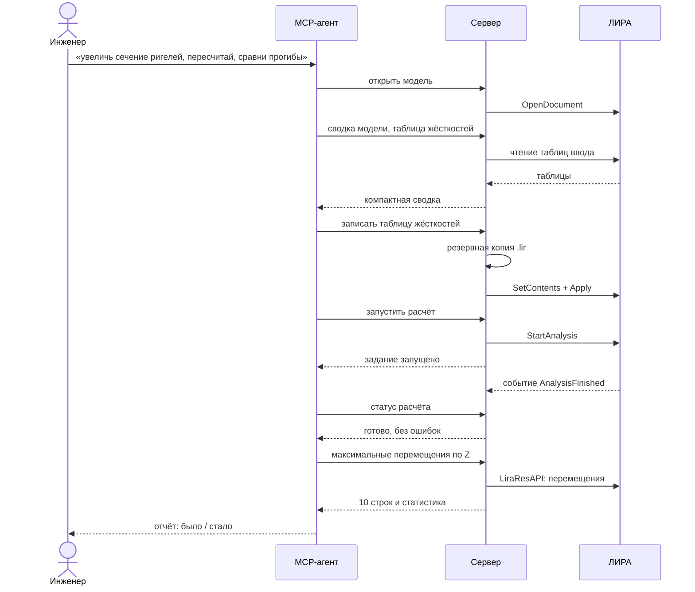

# От задачи до результата

!!! note "Запланировано — ещё не построено"

## Коротко

Инженер просит агента изменить модель, пересчитать её и сравнить результаты. Участвуют
все слои сервера и ЛИРА.

## Последовательность

Как читать: время идёт сверху вниз, сплошные стрелки — запросы, пунктирные — ответы.

## По шагам

1. Агент открывает модель; если ЛИРА не запущена, сервер запускает её через COM.
2. Агент получает сводку модели и читает нужные таблицы ввода.
3. Перед первой правкой сервер сохраняет резервную копию файла модели.
4. Агент записывает таблицу; ЛИРА проверяет её и при ошибках возвращает их по строкам —
   модель тогда не меняется.
5. Расчёт запускается в фоне; агент спрашивает статус, пока расчёт не завершится.
6. Сервер читает результаты, обрабатывает их и отдаёт агенту компактный ответ.

## Когда что-то идёт не так

- ЛИРА открыла модальное окно — агент получает его текст и может нажать кнопку.
- Расчёт завершился ошибкой — агент получает протокол расчёта.
- Нет лицензии или подходящей версии — понятная ошибка при первом вызове.

## Связанное

- [Сервер](../components/server.md)
- [0001 — архитектура](../decisions/0001-architecture.md)
