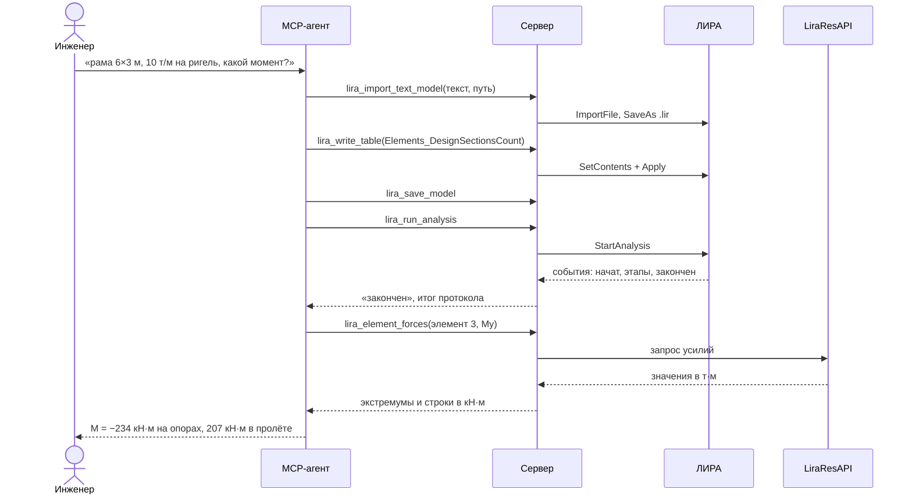

# От задачи до результата

!!! info "Построено на этапе 1"
    Сценарий проверен сквозным тестом `tests/live/test_live_results.py` на живой
    ЛИРЕ 2024 R2. Модальные окна ЛИРЫ сервер находит и называет агенту (этап 3,
    `lira_dialogs`).

## Коротко

Агент строит П-образную раму, рассчитывает её и называет изгибающий момент в ригеле
(пример приёмки №1). Участвуют все слои сервера, ЛИРА и её библиотека результатов.

## Последовательность

Как читать: время идёт сверху вниз, сплошные стрелки — запросы, пунктирные — ответы.

## По шагам

1. Агент передаёт модель в текстовом формате ЛИРЫ: узлы, элементы, жёсткость, связи и
   нагрузку. Инструмент `lira_import_text_model` (`tools/tables.py`) пишет текст во
   временный файл, ЛИРА его импортирует, сервер сохраняет модель в `.lir`.
2. Агент задаёт три расчётных сечения в стержнях таблицей ввода
   `Elements_DesignSectionsCount`, чтобы получить момент в середине пролёта.
   `lira_write_table` перед первой правкой делает резервную копию файла; при ошибках
   ЛИРА возвращает их по строкам, и модель не меняется.
3. Агент сохраняет модель: ЛИРА рассчитывает файл на диске, а не открытый документ,
   поэтому `lira_run_analysis` (`tools/analysis.py`) не запустит расчёт модели с
   несохранёнными правками.
4. Расчёт идёт в ЛИРЕ; сервер ждёт событие окончания (`adapters/analysis.py`), читает
   протокол и возвращает вердикт и все строки «ВНИМАНИЕ!!!». Расчёт геометрически
   изменяемой системы тоже «заканчивается» — отличить его можно только по протоколу.
   После расчёта сервер кладёт рядом с результатами метку: какая модель рассчитана и
   когда (`adapters/stamps.py`).
5. Агент запрашивает усилия: `lira_element_forces` (`tools/results.py`) читает их через
   `LiraResAPI` (`adapters/results.py`), переводит в единицы ЛИРЫ и возвращает по
   каждому семейству КЭ (здесь — стержни) минимум, максимум и первые строки
   (`services/results.py`). По желанию агент сужает ответ порогом, строит огибающую или
   выгружает полную таблицу в CSV/Excel — см. [сервер](../components/server.md).

## Когда что-то идёт не так

- Нет ЛИРЫ 2024+ или лицензии — понятная ошибка при первом вызове.
- Модель не сохранена или изменена — расчёт не запускается, агенту сказано сохранить.
- Результатов нет — «запустите lira_run_analysis для этой модели».
- Результаты под этим именем принадлежат одноимённой модели из другой папки или модель
  сохранена после расчёта — ответ содержит `warning` с причиной и советом пересчитать
  (проверено тем же файлом тестов, `test_results_of_same_named_and_changed_models_carry_warnings`).
- ЛИРА не отвечает дольше тайм-аута — агент получает сообщение о возможном модальном
  окне; обработка окон — этап 3.

## Связанное

- [Сервер](../components/server.md)
- [Эксплуатация](../operations.md)
- [0001 — архитектура](../decisions/0001-architecture.md)
