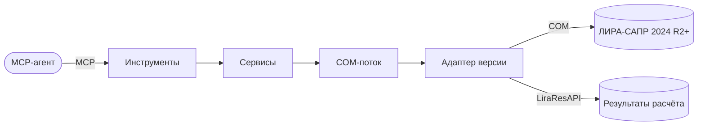

# Lira-Sapr-MCP

MCP-сервер, через который ИИ-агент управляет ЛИРА-САПР на компьютере инженера:
создаёт и редактирует расчётные модели, запускает расчёт и получает результаты.

## Где мы сейчас

- Продукт описан и утверждён — [PRODUCT.md](PRODUCT.md).
- Архитектура утверждена — [ARCHITECTURE.md](ARCHITECTURE.md).
- Этап 1 (тонкий сквозной путь) построен: агент создаёт модель, правит таблицы и
  нагрузки, рассчитывает и получает перемещения и усилия — 20 инструментов. Пример
  приёмки №1 (рама 6×3 м) совпадает с ручным расчётом.
- Дальше — этап 2: все виды результатов, экспорт, высокоуровневые операции и скрипт
  агента. План — [TASKS.md](TASKS.md).

## С чего начать чтение

1. [Что мы делаем](PRODUCT.md)
2. [Как устроено](ARCHITECTURE.md) и [сервер изнутри](components/server.md)
3. [Главный сценарий](flows/main-scenario.md)
4. [Как запустить и подключить к агенту](operations.md)
5. [Что умеет API ЛИРЫ](research/lira-api.md)
