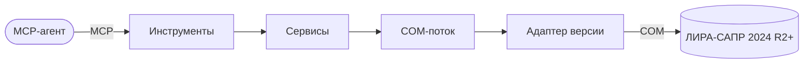

# Lira-Sapr-MCP

MCP-сервер, через который ИИ-агент управляет ЛИРА-САПР на компьютере инженера:
создаёт и редактирует расчётные модели, запускает расчёт и получает результаты.

## Где мы сейчас

- Продукт описан и утверждён — [PRODUCT.md](PRODUCT.md).
- Архитектура утверждена — [ARCHITECTURE.md](ARCHITECTURE.md).
- Кода пока нет; план — [TASKS.md](TASKS.md), этап 1: тонкий сквозной путь.

## С чего начать чтение

1. [Что мы делаем](PRODUCT.md)
2. [Как устроено](ARCHITECTURE.md) и [сервер изнутри](components/server.md)
3. [Главный сценарий](flows/main-scenario.md)
4. [Что умеет API ЛИРЫ](research/lira-api.md)
